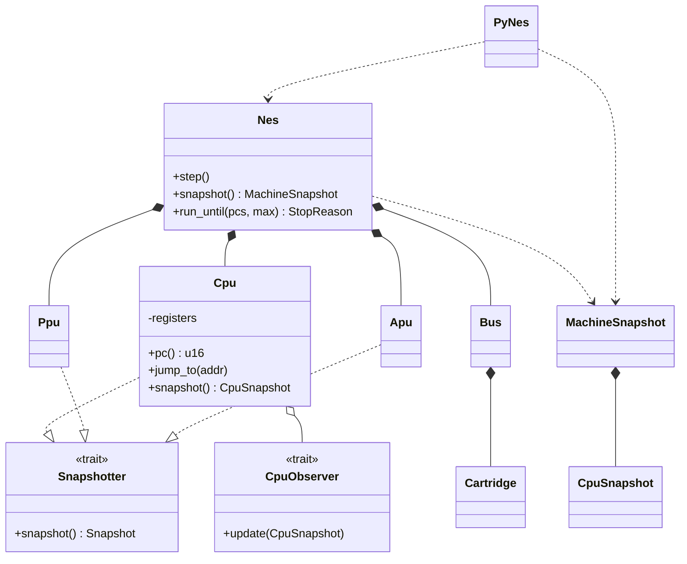

# NES Emulator

A Rust NES emulator with a core library, a desktop app, and a Python bridge.

## Crates

| Crate | Package | Purpose |
|---|---|---|
| `crates/core` | `emulator-core` | CPU, bus, cartridge, PPU, APU |
| `crates/app` | `emulator-app` | Desktop binary |
| `crates/python` | `emulator-python` | Python extension (`_emulator`) |
| `crates/bench` | `test_bench` | Criterion benchmarks |

## Architecture



### Key points

- Emulator state lives in `core`; the Python bridge holds only UI and breakpoint policy.
- The debug/inspection API is gated behind the `debug` Cargo feature (not `debug_assertions`).
- Inspection is pull-based (`Nes::snapshot()`); observers are for streaming/tracing.
- Run loops (`run_until`) execute in Rust and return a stop reason, so FFI happens per stop, not per instruction.
- Debug memory access uses side-effect-free `peek`/`poke`; watchpoints are checked in-loop.

## Build

```sh
cargo build
cargo run -p emulator-app
cargo test -p emulator-core --features debug
```

Python extension:

```sh
python3 -m venv .venv && source .venv/bin/activate
pip install maturin
cd crates/python && maturin develop --release
```

## Status

- CPU, bus, and cartridge are implemented; `nestest` and `instr_test-v5` are the end-to-end tests.
- PPU and APU are stubs; illegal opcodes and mappers are not implemented.
- The debug API is partially wired; the Python bridge is a work in progress.
